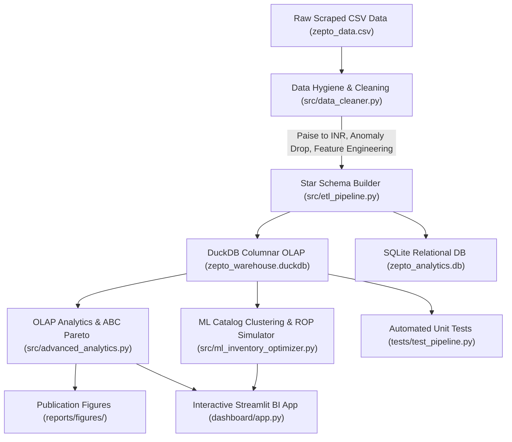

# ⚡ Zepto Quick-Commerce Analytics Platform
## Complete Master Project Guide & Interview Preparation Manual

---

## 1. Project Overview & Business Domain

### What is Quick-Commerce?
Quick-commerce (q-commerce) is hyperlocal, ultra-fast delivery (typically **10 to 15 minutes**) of groceries, fresh produce, and daily essentials. Unlike traditional e-commerce (e.g., Amazon, Flipkart) which ships from massive regional fulfillment centers over 1–3 days, quick-commerce relies on a dense network of **Dark Stores** (micro-fulfillment centers) located directly inside residential urban neighborhoods.

### Key Dark Store Operational Realities
1. **Strict Shelf Capacity**: A typical dark store is compact (2,000–3,500 sq. ft.) and can only hold **1 to 6 units per SKU** on active picking shelves.
2. **High Stockout Risk**: Because shelf depth is shallow, sudden surges in orders cause stockouts quickly. In q-commerce, if milk or bread is out of stock, customers immediately switch to a rival app (Blinkit, Instamart).
3. **Courier Payload Limits**: Orders are delivered via two-wheelers (motorcycles, scooters, bicycles) where the delivery bag has a strict physical weight limit of **10 to 12 kg**.
4. **Perishable vs. Ambient Mix**: Fast churn on perishables (milk, vegetables) with short shelf life vs. high-margin slow-moving ambient items (cosmetics, gourmet chocolates).

### Project Mission
To transform raw scraped quick-commerce catalog and inventory data into an **enterprise-grade decision-support platform** that optimizes inventory capital, models stockout revenue leakage, segments products using machine learning, and streamlines delivery logistics.

---

## 2. Technical Architecture & Data Pipeline



### Component Breakdown
- **`src/data_cleaner.py`**: Validates data hygiene, scrubs zero-MRP anomalies, converts currency from paise to INR (`/ 100.0`), audits advertised vs. effective discounts, and computes logistics metrics (revenue density per kg, price per gram).
- **`src/etl_pipeline.py`**: Normalizes flat records into a Star Schema (`dim_category`, `dim_product`, `fact_inventory`, `zepto_inventory_master`) and materializes analytical views in both DuckDB and SQLite.
- **`sql/`**: Modular enterprise SQL suite:
  - `01_ddl_schema.sql`: Table definitions, foreign keys, and indexes.
  - `02_data_cleaning_audit.sql`: Constraint checks, discount discrepancies, IQR statistical outlier queries.
  - `03_intermediate_staging.sql`: View layers for dimensional rollups.
  - `04_advanced_analytics.sql`: 12+ real-world analytical queries using window functions (`ROW_NUMBER`, `DENSE_RANK`, `NTILE`, `PERCENT_RANK`), CTEs, and cumulative sums.
  - `05_business_kpis.sql`: Executive metrics, GMV potential, capital-to-weight ratios.
  - `06_inventory_optimization.sql`: ABC Pareto classification, safety stock, and reorder point triggers.
- **`src/ml_inventory_optimizer.py`**: Unsupervised K-Means clustering ($k=4$) for catalog archetypes, safety stock simulator, and price elasticity margin recovery modeling.
- **`dashboard/app.py`**: Multi-page interactive Streamlit web application with real-time sidebar filters, Plotly visualizations, and a live in-browser DuckDB SQL query console.
- **`tests/test_pipeline.py`**: 6 automated unit tests verifying schema integrity, zero-price absence, currency normalization, and mathematical consistency.

---

## 3. "Why Use This Concept?" — Design Decisions & Trade-Offs

### 1. Why Star Schema instead of a Single Flat Table?
* **Problem**: Storing everything in one flat denormalized table creates data duplication (repeating category descriptions and product names 3,700+ times), increases storage, and violates relational integrity.
* **Why Star Schema?**: 
  - Separates static dimensional metadata (`dim_category`, `dim_product`) from fast-changing transactional metrics (`fact_inventory`).
  - Enables easy slicing and dicing across dimensions without table locks.
  - Standard industry pattern used across enterprise data warehouses (Snowflake, BigQuery, Databricks).

### 2. Why DuckDB for the Analytical Engine?
* **Problem**: Traditional databases (PostgreSQL, MySQL) require separate servers, configuration, user permissions, and connection pooling. They are row-oriented, making large aggregations (`SUM`, `AVG`, `PERCENTILE`) slower. SQLite, while portable, is row-based and lacks modern analytical window capabilities.
* **Why DuckDB?**:
  - **Vectorized Columnar Execution**: Executes analytical queries across thousands of records in sub-milliseconds.
  - **Zero Server Setup**: In-process engine that runs directly inside Python.
  - **Native Parquet & Arrow Integration**: Queries Parquet files and Pandas DataFrames with zero memory copying.

### 3. Why Pareto ABC Inventory Classification (80/20 Rule)?
* **Problem**: Managing 3,700+ SKUs with the same level of attention is impossible and inefficient. Treating a ₹10 salt packet the same as a ₹1,200 saffron box leads to misallocated capital.
* **Why ABC Segmentation?**:
  - **Class A (Top 70% value, ~34% of SKUs)**: High-priority revenue drivers that require 99.5% service level and daily replenishment.
  - **Class B (Next 20% value, ~27% of SKUs)**: Moderate velocity items with standard safety stocks.
  - **Class C (Bottom 10% value, ~38% of SKUs)**: Long-tail assortment that risks gathering dust and expiring. Identifies candidates for catalog rationalization.

### 4. Why K-Means Machine Learning Clustering?
* **Problem**: Traditional categories (e.g., "Munchies", "Cooking Essentials") group products only by biological or culinary type, ignoring economic and logistical traits. A 5kg bag of Atta and a 50g spice jar are both in "Cooking Essentials", but their storage and delivery dynamics are completely opposite.
* **Why K-Means?**:
  - Uses multidimensional normalization (`price`, `discount_percent`, `weight`, `available_quantity`) to discover **behavioral archetypes**:
    1. *Everyday High-Velocity Staples*
    2. *Promotional / Deep-Discount Drivers*
    3. *Premium High-Margin Anchors*
    4. *Heavy Bulk Goods (Logistical Drag)*

### 5. Why Delivery Payload & Revenue Density ($\text{₹}/\text{kg}$) Optimization?
* **Problem**: Quick-commerce deliveries are executed by delivery partners on two-wheelers with a bag limit of 10–12 kg. If a customer orders two 5kg bags of Atta, the rider's bag is full, yet the margin earned on Atta is thin.
* **Why Revenue Density?**:
  - Evaluates **₹ earned per kilogram of physical shelf space and courier payload**.
  - Highlights space champions (*Personal Care, Saffron, Cosmetics* at ~₹1,850/kg) vs. delivery drags (*Watermelons, Potatoes, Atta* at <₹150/kg).
  - Enables basket-level weight balancing algorithms to pair light high-margin items with heavy groceries.

### 6. Why Automated Unit Tests & Data Quality Audits?
* **Problem**: Real-world scraped or transactional datasets contain corrupted rows, scraping glitches (e.g. ₹0 MRP), currency unit mismatches (paise vs rupees), and null values that invalidate executive dashboards.
* **Why Unit Tests?**:
  - Automatically validates that zero-price records are filtered out.
  - Verifies that currency conversions (`paise / 100.0`) are mathematically sound.
  - Ensures foreign-key integrity between fact and dimension tables.

---

## 4. Key Quantitative Results & Business Impact

| Metric | Measured Value | Business Insight |
| :--- | :--- | :--- |
| **Total Catalog Assortment** | 3,731 SKUs (1,673 unique items) | 14 active merchandise categories |
| **Active Inventory Valuation** | **₹22,43,080.60** | Capital tied up across dark store shelf stock |
| **Stockout Rate** | **12.14%** (453 out of 3,732 SKUs) | Critical availability bottleneck |
| **Stockout Lost Revenue Impact** | **₹1,78,058.90** | Unfulfilled gross demand from out-of-stock items |
| **Class A Concentration** | 1,129 SKUs (34.4%) = **70.0% of Capital** | Extreme capital concentration in top 1/3 of catalog |
| **Total Dark Store Payload** | **6,005.85 kg (6.0 metric tonnes)** | Physical storage weight constraint |
| **Margin Recovery Simulation** | **+₹10,183.98 per cycle** | Trimming discounts by 3% on 180 price-inelastic luxury items |

---

## 5. 25 High-Frequency Interview Questions & Answers

### Section A: Project Overview & Behavioral Questions

#### Q1. Can you walk me through this project and what motivated it?
> **Answer**:  
> "I developed an end-to-end quick-commerce inventory and sales intelligence platform modeled on Zepto's dark store operations. In quick-commerce, micro-fulfillment warehouses operate under unique constraints: micro-shelves holding only 1 to 6 units per SKU, two-wheeler delivery riders capped at 10–12 kg payload limits, and high customer churn risk when items go out of stock.  
> I built an automated ETL pipeline that cleaned messy scraped catalog data, modeled it into a Star Schema, stored it in DuckDB and SQLite, executed 25+ advanced OLAP SQL queries, implemented an ABC Pareto classification and K-Means clustering model, and built an interactive Streamlit BI application. The project quantified a ₹1.78 Lakh revenue loss due to a 12.14% stockout rate and identified ₹10.1k in immediate margin recovery through discount optimization."

#### Q2. What was the biggest data quality challenge you faced, and how did you resolve it?
> **Answer**:  
> "The raw dataset had three major issues:  
> 1. **Currency in Paise**: Prices were stored as integers in paise (e.g., 2500 paise for ₹25), which would distort financial reporting if treated as rupees.  
> 2. **Data Anomalies**: Corrupted scraping rows had ₹0 MRP and zero weights.  
> 3. **Discount Inconsistencies**: Over 400 records showed a divergence between advertised discount percentage and the actual discount calculated between MRP and selling price.  
> I engineered a Python cleaning module (`src/data_cleaner.py`) with strict validation assertions: dropped invalid ₹0 MRP items, converted paise to INR (`/ 100.0`), recomputed effective discount percentages, and added automated unit tests (`tests/test_pipeline.py`) to guarantee zero invalid prices enter the warehouse."

#### Q3. What is the business value of your project for a category manager or dark store lead?
> **Answer**:  
> "It provides three immediate, high-ROI capabilities:  
> 1. **Prioritized Restock Worklist**: Instead of guessing what to reorder, store managers get an automated P0–P3 replenishment list ranked by lost GMV opportunity cost.  
> 2. **Catalog Rationalization**: Identifies the 1,263 Class C SKUs that tie up shelf space while contributing only 10% of revenue.  
> 3. **Logistics Payload Optimization**: Flags heavy bulk items (<₹150/kg revenue density) that strain delivery bags so store managers can pair them with compact, high-margin products."

#### Q4. If you had 3 more weeks to work on this, what would you add?
> **Answer**:  
> "I would add:  
> 1. **Time-Series Demand Forecasting**: Using Prophet or ARIMA on historical hourly order volumes to predict intra-day demand spikes (e.g. morning milk/bread vs evening snacks/ice cream).  
> 2. **Real-Time Streaming**: Implementing Apache Kafka / Redpanda to stream inventory decrements in real-time as orders are placed.  
> 3. **Delivery Bag Knapsack Optimization**: An integer linear programming (ILP) algorithm that dynamically optimizes multi-order batching per delivery rider to maximize GMV while staying under the 10 kg limit."

---

### Section B: SQL & Advanced Analytics Deep Dive

#### Q5. How did you compute the cumulative Pareto revenue percentage in SQL?
> **Answer**:  
> "I used Common Table Expressions (CTEs) combined with window functions:
> ```sql
> WITH ranked_skus AS (
>     SELECT 
>         sku_id,
>         product_name,
>         category,
>         inventory_holding_value_inr,
>         SUM(inventory_holding_value_inr) OVER () AS grand_total,
>         SUM(inventory_holding_value_inr) OVER (
>             ORDER BY inventory_holding_value_inr DESC, sku_id
>         ) AS running_val
>     FROM zepto_inventory_master
>     WHERE out_of_stock = FALSE
> )
> SELECT 
>     *,
>     ROUND(100.0 * running_val / grand_total, 2) AS cumulative_pct,
>     CASE 
>         WHEN (100.0 * running_val / grand_total) <= 70.0 THEN 'Class A'
>         WHEN (100.0 * running_val / grand_total) <= 90.0 THEN 'Class B'
>         ELSE 'Class C'
>     END AS abc_class
> FROM ranked_skus;
> ```
> The first window function `SUM() OVER ()` calculates the total portfolio value across all rows, while the second `SUM() OVER (ORDER BY ... DESC)` computes the running cumulative sum. Dividing them yields the cumulative percentage."

#### Q6. What is the difference between `RANK()`, `DENSE_RANK()`, and `ROW_NUMBER()`, and which one did you use for SKU rankings?
> **Answer**:  
> "* `ROW_NUMBER()`: Always assigns a distinct sequential integer (1, 2, 3, 4) regardless of ties.  
> * `RANK()`: Assigns the same rank to identical values but skips subsequent numbers on ties (e.g., 1, 2, 2, 4).  
> * `DENSE_RANK()`: Assigns the same rank to identical values without skipping numbers (e.g., 1, 2, 2, 3).  
> For category top-performers and restock priorities, I used **`DENSE_RANK()`** because if two out-of-stock SKUs share the exact same revenue loss, they should share the same priority tier without creating gaps in ranking."

#### Q7. How did you identify pricing outliers within each category using SQL?
> **Answer**:  
> "I used the Interquartile Range (IQR) technique in SQL using `PERCENTILE_CONT`:
> ```sql
> WITH quartiles AS (
>     SELECT 
>         category,
>         PERCENTILE_CONT(0.25) WITHIN GROUP (ORDER BY price_per_gram_inr) AS q1,
>         PERCENTILE_CONT(0.75) WITHIN GROUP (ORDER BY price_per_gram_inr) AS q3
>     FROM zepto_inventory_master
>     WHERE price_per_gram_inr > 0
>     GROUP BY category
> )
> SELECT m.*
> FROM zepto_inventory_master m
> JOIN quartiles q ON m.category = q.category
> WHERE m.price_per_gram_inr > (q.q3 + 1.5 * (q.q3 - q.q1));
> ```
> This calculates $Q_1$ (25th percentile) and $Q_3$ (75th percentile) per category, determines the upper threshold $Q_3 + 1.5 \times \text{IQR}$, and filters products exceeding it."

#### Q8. What is `NTILE()` and how did you apply it?
> **Answer**:  
> "`NTILE(n)` is a window function that divides an ordered partition into $n$ approximately equal buckets. I used `NTILE(4) OVER(PARTITION BY category ORDER BY discounted_price_inr)` to divide SKUs into four price quartiles (Budget, Core Economy, Premium, and Luxury) within each specific category. This allowed us to benchmark product prices relative to their category peers rather than the entire diverse catalog."

#### Q9. How did you calculate the Relative Price Index (RPI)?
> **Answer**:  
> "The Relative Price Index compares an item's selling price to the average selling price of its category:
> $$\text{RPI} = \frac{\text{discounted\_price\_inr}}{\text{AVG}(\text{discounted\_price\_inr})\text{ OVER}(\text{PARTITION BY category})}$$
> An RPI > 1.5 identifies premium products (>50% more expensive than category average), while an RPI < 0.6 flags budget anchors."

#### Q10. What is a Common Table Expression (CTE) and why prefer it over subqueries?
> **Answer**:  
> "A CTE (`WITH clause`) creates a temporary named result set available for the duration of a query. Compared to nested subqueries, CTEs:
> 1. **Dramatically improve readability and maintainability** by breaking complex multi-step transformations into logical steps.
> 2. **Allow reusability**, referencing the same CTE multiple times within a single query without duplicating code.
> 3. Modern query planners in DuckDB and PostgreSQL optimize CTEs effectively."

---

### Section C: Data Engineering, ETL & Performance

#### Q11. Why did you choose a dual-database approach (DuckDB + SQLite)?
> **Answer**:  
> "To demonstrate versatility across OLAP (analytical) and OLTP (transactional) workloads:  
> * **DuckDB** acts as our **OLAP analytical warehouse**: Its vectorized columnar engine executes complex aggregations, window functions, and Parquet scans at blazing speeds.  
> * **SQLite** acts as our **portable relational operational store**: It provides B-Tree indexing and universal compatibility with standard embedded tools and edge microservices without installing database drivers."

#### Q12. How does columnar storage (DuckDB / Parquet) differ from row-based storage (PostgreSQL / SQLite)?
> **Answer**:  
> "* **Row-based storage**: Stores data row-by-row on disk (`[id, name, price, stock], [id, name, price, stock]`). Ideal for OLTP where you insert, update, or fetch a single user's record by primary key.  
> * **Columnar storage**: Stores all values of a column consecutively on disk (`[price1, price2, price3...], [stock1, stock2, stock3...]`). When running queries like `AVG(price)` or `SUM(holding_value)`, columnar engines only read that specific column from disk, saving massive I/O and enabling SIMD vectorized CPU instructions."

#### Q13. How did you structure your ETL pipeline to ensure idempotency?
> **Answer**:  
> "Idempotency means running the pipeline multiple times produces the exact same state without duplicating data. I implemented idempotency by:
> 1. Using deterministic surrogate keys (`sku_id`, `product_id`, `category_id`) derived from sorted natural keys.
> 2. Using `CREATE OR REPLACE TABLE` in DuckDB and `if_exists="replace"` with transactional DDL in SQLite.
> 3. Automated quality checks that fail the pipeline before writing corrupted data."

#### Q14. What unit tests did you implement and why?
> **Answer**:  
> "I wrote 6 unit tests using Python's `unittest` framework:
> 1. `test_01_processed_files_exist`: Confirms CSV and Parquet files were successfully written and are non-empty.
> 2. `test_02_no_invalid_prices`: Asserts `mrp_inr > 0`, `discounted_price_inr > 0`, and `selling_price <= mrp`.
> 3. `test_03_currency_conversion`: Verifies prices are correctly scaled from paise to rupees (asserts max MRP is within realistic ₹ INR range).
> 4. `test_04_duckdb_integrity`: Checks that all 4 tables exist and row counts match expectations.
> 5. `test_05_sqlite_integrity`: Checks SQLite table accessibility and index creation.
> 6. `test_06_abc_classification_coverage`: Verifies all active items are mapped to Class A, B, or C."

---

### Section D: Quick-Commerce Supply Chain & Business Strategy

#### Q15. How did you estimate the lost revenue from out-of-stock SKUs?
> **Answer**:  
> "In quick-commerce dark stores, inventory depth per active SKU is tightly bounded (1 to 6 units, averaging 4.56 units). When an SKU goes out of stock, it indicates that at least one full store replenishment cycle of demand was unfulfilled.  
> We calculated estimated stockout loss as:
> $$\text{Stockout Loss} = \text{discounted\_price\_inr} \times \bar{Q}_{\text{in-stock}}$$
> where $\bar{Q}_{\text{in-stock}} = 4.56\text{ units}$. Across 453 out-of-stock items, this revealed **₹1,78,058.90** in unfulfilled demand."

#### Q16. What is the difference between traditional e-commerce warehouse fulfillment and quick-commerce dark stores?
> **Answer**:  
> | Feature | Traditional E-Commerce (Amazon) | Quick-Commerce (Zepto) |
> | :--- | :--- | :--- |
> | **Delivery Time** | 24 to 72 hours | 10 to 15 minutes |
> | **Warehouse Location** | Distant suburbs (massive 500k+ sq.ft.) | City centers / neighborhoods (2k–4k sq.ft.) |
> | **Shelf Depth** | Hundreds of units per SKU | 1 to 6 units per SKU |
> | **Picking Speed** | 10–15 minutes per batch | 90 to 120 seconds per order |
> | **Delivery Vehicle** | Vans and large freight trucks | Two-wheelers with ~10–12 kg backpacks |

#### Q17. What is Reorder Point (ROP) and how did you model it?
> **Answer**:  
> "Reorder Point is the threshold level of inventory that triggers a purchase order:
> $$\text{ROP} = (\text{Daily Demand} \times \text{Lead Time}) + \text{Safety Stock}$$
> In our dark store model:
> - **Lead time** $= 0.5\text{ days}$ (12 hours, since mother warehouses dispatch twice daily).
> - **Velocity Multipliers**: 2.5x for Perishables (milk, bread), 1.8x for Impulse snacks, 1.0x for Ambient goods.
> - **Safety Stock**: $\lceil 0.5 \times \text{Daily Demand}\rceil$.  
> When `available_quantity <= ROP`, the system triggers an immediate reorder."

#### Q18. What is 'Margin Bleed' and how did you detect it?
> **Answer**:  
> "Margin bleed occurs when a business offers steep discounts (>20%) on high-ticket, price-inelastic items (e.g. ₹500+ olive oil, specialty ghee, premium wellness products). Consumers buying premium items are generally insensitive to a 2–3% price difference, meaning deep discounts unnecessarily sacrifice gross margin.  
> We filtered products where $\text{MRP} \ge \text{₹400}$ and $\text{Discount} \ge 20\%$. Our simulation proved that trimming discounts by just 3.0% on 180 SKUs immediately recaptures **+₹10,183.98 in gross margin** per replenishment cycle."

---

### Section E: Machine Learning & Decision Science

#### Q19. Why did you use K-Means clustering instead of just using existing categories?
> **Answer**:  
> "Existing categories are purely taxonomic (e.g., 'Dairy' vs 'Snacks'). They tell us what the item is, but not how it behaves logistically or commercially.  
> By feeding four normalized continuous variables (`price`, `discount_percent`, `weight`, `available_quantity`) into K-Means with $k=4$, the algorithm clustered products into 4 distinct operational archetypes:
> 1. **High-Velocity Core Staples** (Everyday price, steady stock).
> 2. **Discount & Promotional Drivers** (High discount %, impulse items).
> 3. **Premium High-Margin Anchors** (Low weight, high price, high revenue density).
> 4. **Heavy Bulk Goods** (High weight >2kg, low revenue density, logistics burden).  
> This allows category managers to apply pricing and logistics strategies tailored to how items move, not just what they are."

#### Q20. How did you prepare data for K-Means clustering?
> **Answer**:  
> "1. **Handled Nulls & Zeros**: Cleaned zero weights and imputed missing values.  
> 2. **Feature Scaling with `StandardScaler`**: Price ranges from ₹10 to ₹2,600, while discount ranges from 0% to 50%, and weight from 10g to 10,000g. Without scaling, Euclidean distance in K-Means would be dominated almost entirely by weight and price. `StandardScaler` subtracted the mean and scaled each feature to unit variance ($\mu=0, \sigma=1$).  
> 3. **$k$-Selection**: Tested cluster separation using inertia and chose $k=4$ to reflect clear, actionable retail archetypes."

---

## 6. 60-Second Elevator Pitch (Memorize This for Interviews)

> *"In this project, I built a production-grade quick-commerce inventory intelligence platform modeled on Zepto's dark store operations.  
> 
> Quick-commerce dark stores operate under extreme constraints: micro-shelves holding only 1 to 6 units per SKU, tight 10–12 kg delivery rider backpack limits, and high customer churn when essentials stock out.  
> 
> I engineered an automated Python ETL pipeline that cleaned 3,700+ SKUs, modeled them into a Star Schema, and loaded them into DuckDB for sub-millisecond vectorized OLAP queries. I implemented 25+ advanced SQL queries using window functions and CTEs to perform Pareto ABC inventory classification, identifying that 34% of SKUs drive 70% of inventory value. I also built a K-Means clustering model for catalog archetype discovery and simulated a ₹1.78 Lakh revenue loss across 453 out-of-stock items.  
> 
> Finally, I deployed an interactive Streamlit BI application with Plotly analytics and an in-browser live SQL execution console. The entire project is packaged with automated unit tests, master CLI orchestration, and complete documentation on GitHub."*
